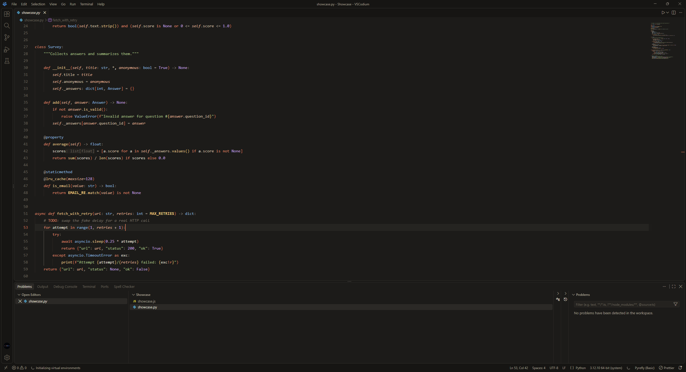
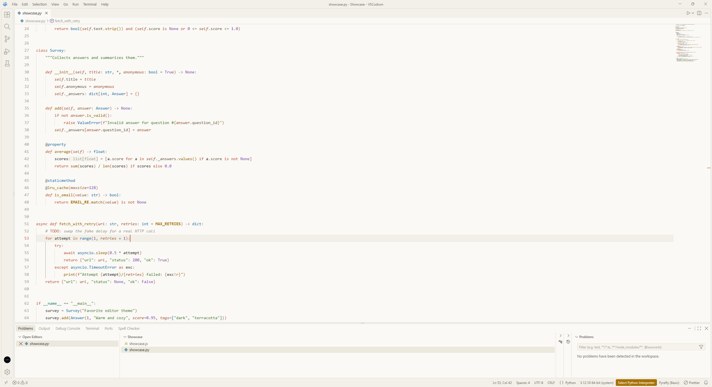

<p align="center">
  
</p>

# Claude Sleek

Warm, modern, minimal color themes built around a terracotta accent.

- **Claude Ember** (dark): warm charcoal, never blue-black.
- **Claude Parchment** (light): cream paper, ink text, a deeper terracotta for contrast.

> Unofficial. This is a fan-made theme inspired by Claude's look and is not affiliated with or endorsed by Anthropic.

## Screenshots

| Claude Ember | Claude Parchment |
| --- | --- |
|  |  |
|  |  |
|  |  |

## Features

- Flat, borderless chrome: activity bar, sidebar, tabs, title bar and status bar share one calm tone.
- Terracotta accent on the active tab, cursor, active line number, buttons and badges.
- Bracket pair colors and semantic highlighting tuned to the palette.
- Full 16-color terminal palette, readable in both modes (including dim ANSI text in the light theme).

## Install

**VSCodium / any editor using Open VSX:** open the Extensions view and search for **Claude Sleek**.

**From a VSIX:** download `claude-sleek-1.0.0.vsix` from the Releases page, then Extensions view, `...` menu, **Install from VSIX...**.

**Manually:** copy this folder into your extensions folder (`%USERPROFILE%\.vscode-oss\extensions\` for VSCodium, `~/.vscode/extensions/` for VS Code) and restart.

Then press `Ctrl+K Ctrl+T` and pick a theme.

## Optional settings

```json
{
  "workbench.colorTheme": "Claude Ember",
  "window.autoDetectColorScheme": true,
  "workbench.preferredDarkColorTheme": "Claude Ember",
  "workbench.preferredLightColorTheme": "Claude Parchment",
  "editor.semanticHighlighting.enabled": true,
  "editor.bracketPairColorization.enabled": true,
  "editor.guides.bracketPairs": "active",
  "editor.fontLigatures": true
}
```

## Palette

| Role | Ember | Parchment |
| --- | --- | --- |
| Background | `#1c1b19` | `#faf9f5` |
| Accent | `#d97757` | `#c4573a` |
| Keywords | `#e48a6c` | `#bf5232` |
| Strings | `#abc58c` | `#4a7a2e` |
| Functions | `#efca8e` | `#966000` |
| Types | `#8fbde3` | `#1d6ba5` |
| Numbers | `#c8a5ea` | `#7d47b0` |

## Try it on the demo files

The `demo/` folder has two small files (Python and JavaScript) used for the screenshots, handy for comparing changes.

## Feedback

Spotted a color that looks off? Open an issue with a screenshot and the file type.

## License

MIT, see [LICENSE](LICENSE).
