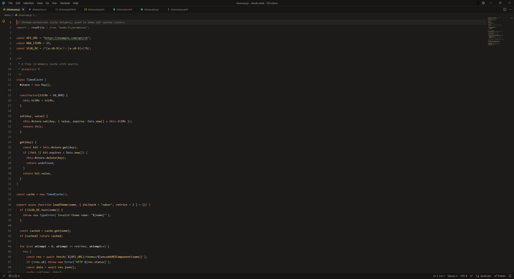
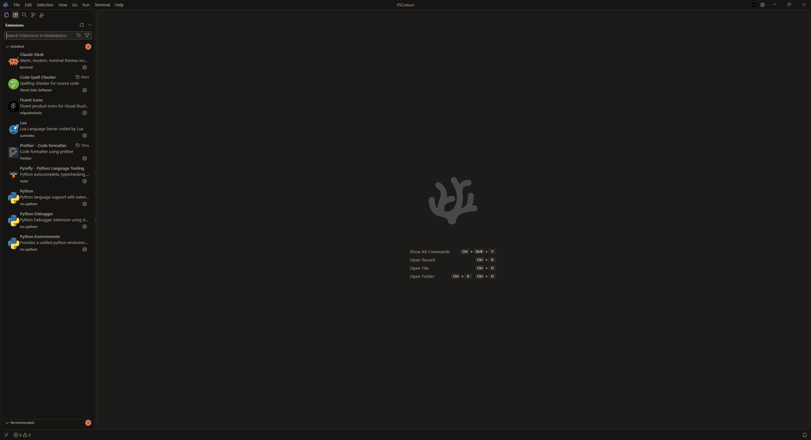
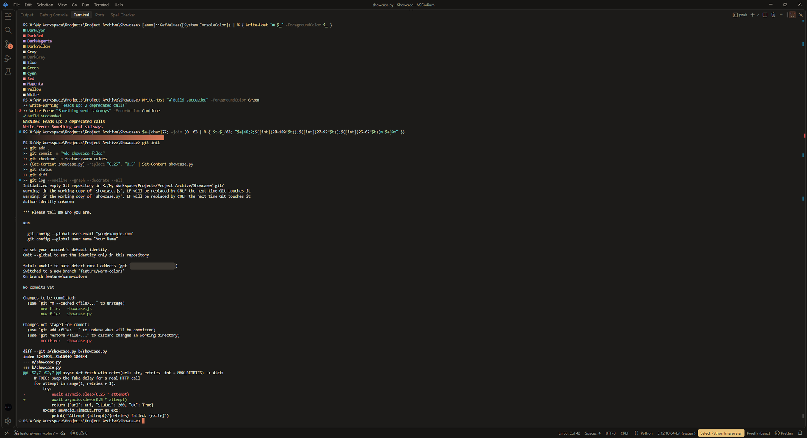
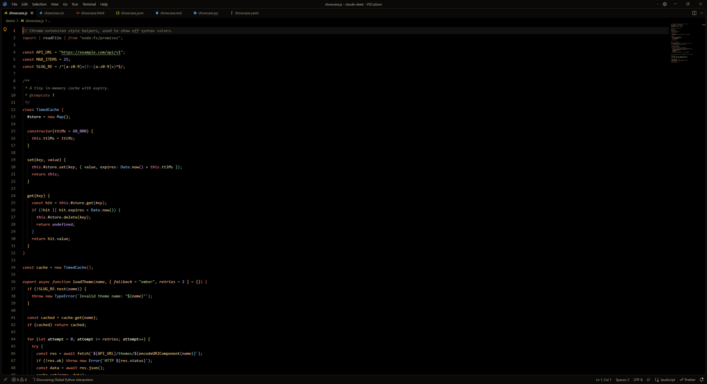
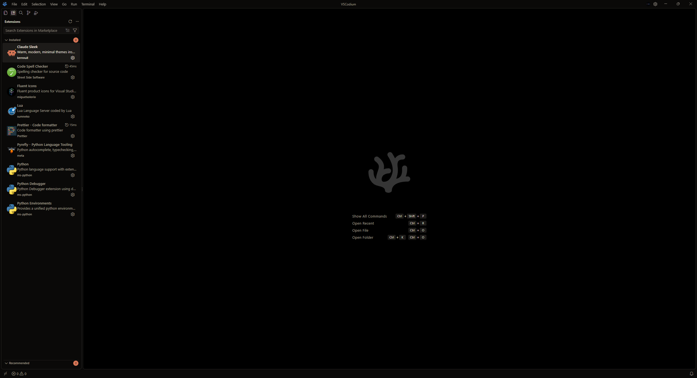
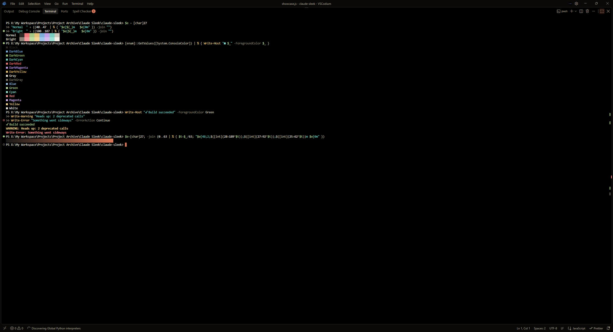
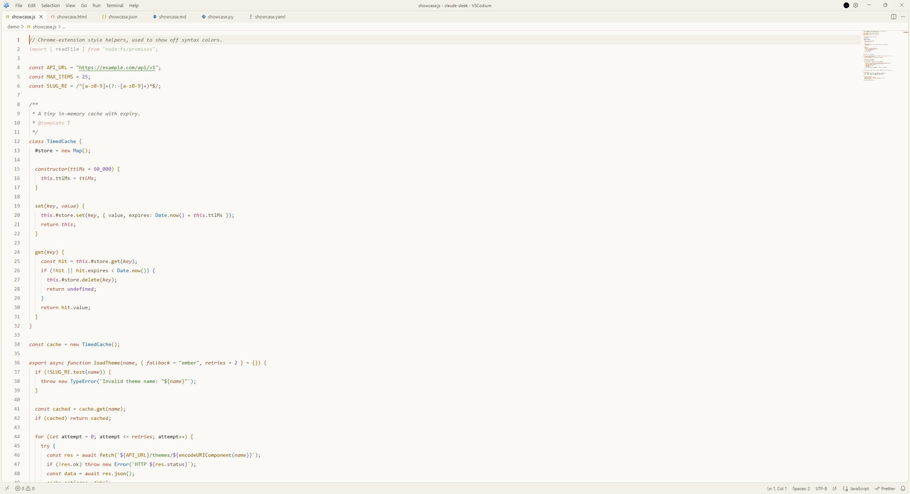
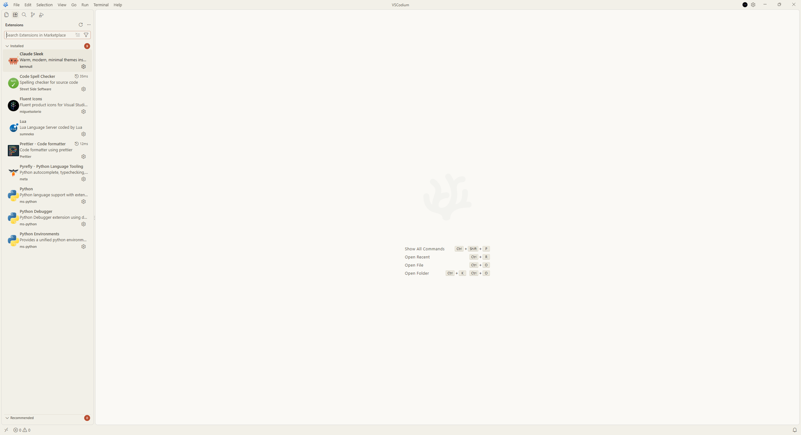
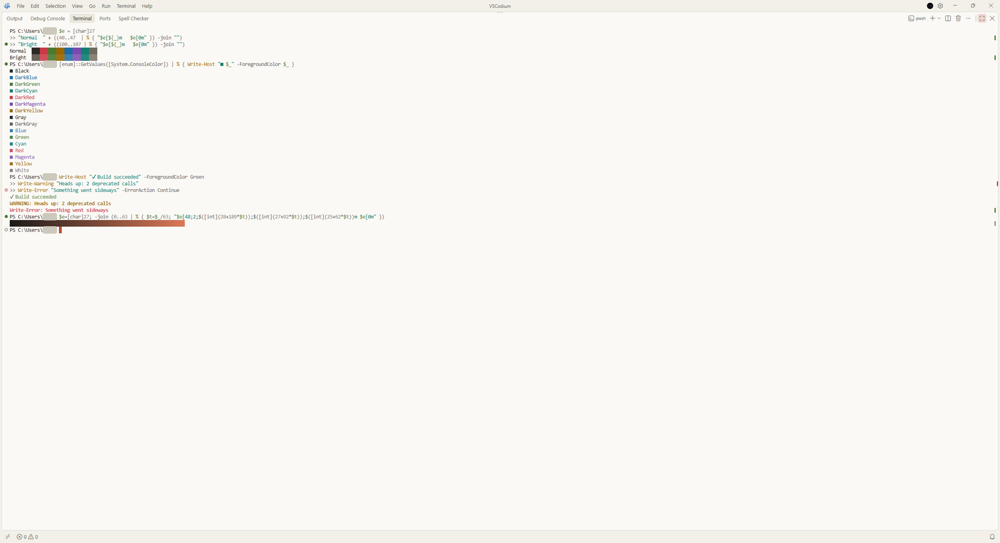

<p align="center">
  
</p>

# Claude Sleek

Warm, modern, minimal color themes built around a terracotta accent. Three looks (dark, true black, light), each with a no-italics variant, tuned for readable code and a calm, flat interface.

> Unofficial. This is a fan-made theme inspired by Claude's look and is not affiliated with or endorsed by Anthropic.

## Themes

| Theme | Mode | What it is |
| --- | --- | --- |
| **Claude Ember** | dark | The main dark theme. Warm charcoal (`#1c1b19`) with a terracotta accent, built to be easy on the eyes through a long day. |
| **Claude Ember Black** | dark | Ember's exact colors on true black (`#000000`) with near-black panels. Deeper contrast, and it saves power on OLED screens. |
| **Claude Parchment** | light | The light theme. Cream paper (`#faf9f5`), ink-dark text and a deeper terracotta accent so everything stays readable on a bright background. |
| **Claude Ember (No Italics)** | dark | Ember without italic text. |
| **Claude Ember Black (No Italics)** | dark | Ember Black without italic text. |
| **Claude Parchment (No Italics)** | light | Parchment without italic text. |

The No Italics variants use exactly the same colors as their parent themes. They only drop the italics on comments, parameters, `this` / `self`, keywords such as `class`, `async` and `import`, HTML attributes, CSS pseudo-selectors, and Markdown emphasis and quotes. Pick them if your font has an italic style you dislike.

## Screenshots

All screenshots show the files in [`demo/`](demo) in VSCodium. Each theme is shown with the editor, the interface, and the terminal (a 16-color palette plus real command output).

### Claude Ember



| Interface | Terminal |
| --- | --- |
|  |  |

### Claude Ember Black



| Interface | Terminal |
| --- | --- |
|  |  |

### Claude Parchment



| Interface | Terminal |
| --- | --- |
|  |  |

## Features

- Flat, borderless chrome: activity bar, sidebar, tabs, title bar and status bar share one calm tone.
- Terracotta accent on the active tab, cursor, active line number, buttons and badges.
- Bracket pair colors with soft guides, and semantic highlighting tuned to the palette.
- Tuned syntax for Markdown, JSON, YAML, HTML and CSS/SCSS, on top of the usual languages.
- Styled sticky scroll, outline and symbol icons, notebooks, tests, settings editor and chat panel.
- Full 16-color terminal palette, readable in every theme (including dim ANSI text in the light theme).
- Text colors checked against WCAG contrast: 4.5:1 for text, 3:1 for line numbers and icons.

## Install

**VSCodium / any editor using Open VSX:** open the Extensions view and search for **Claude Sleek**.

**From a VSIX:** download `claude-sleek-1.1.1.vsix` from the Releases page, then Extensions view, `...` menu, **Install from VSIX...**.

**Manually:** copy this folder into your extensions folder (`%USERPROFILE%\.vscode-oss\extensions\` for VSCodium, `~/.vscode/extensions/` for VS Code) and restart.

Then press `Ctrl+K Ctrl+T` and pick a theme.

## Optional settings

```json
{
  "workbench.colorTheme": "Claude Ember",
  "window.autoDetectColorScheme": true,
  "workbench.preferredDarkColorTheme": "Claude Ember",
  "workbench.preferredLightColorTheme": "Claude Parchment",
  "editor.semanticHighlighting.enabled": true,
  "editor.bracketPairColorization.enabled": true,
  "editor.guides.bracketPairs": "active",
  "editor.fontLigatures": true
}
```

## Palette

| Role | Ember | Parchment |
| --- | --- | --- |
| Background | `#1c1b19` (Black: `#000000`) | `#faf9f5` |
| Accent | `#d97757` | `#b84d30` |
| Keywords | `#e48a6c` | `#b84d2d` |
| Strings | `#abc58c` | `#4a7a2e` |
| Functions | `#efca8e` | `#8a5800` |
| Types | `#8fbde3` | `#1d6ba5` |
| Numbers | `#c8a5ea` | `#7d47b0` |

## Demo files

The `demo/` folder has small sample files (Python, JavaScript, Markdown, JSON, YAML, HTML, CSS) for trying the themes and comparing changes.

## Development

The theme files are generated from the palettes in one script, so a color change is a one-line edit:

```
python tools/generate_themes.py   # rebuild themes/ and the theme list in package.json
python tools/check_contrast.py    # check every theme for valid colors and readable contrast
```

## Feedback

Spotted a color that looks off? Open an issue with a screenshot and the file type.

## License

MIT, see [LICENSE](LICENSE).
