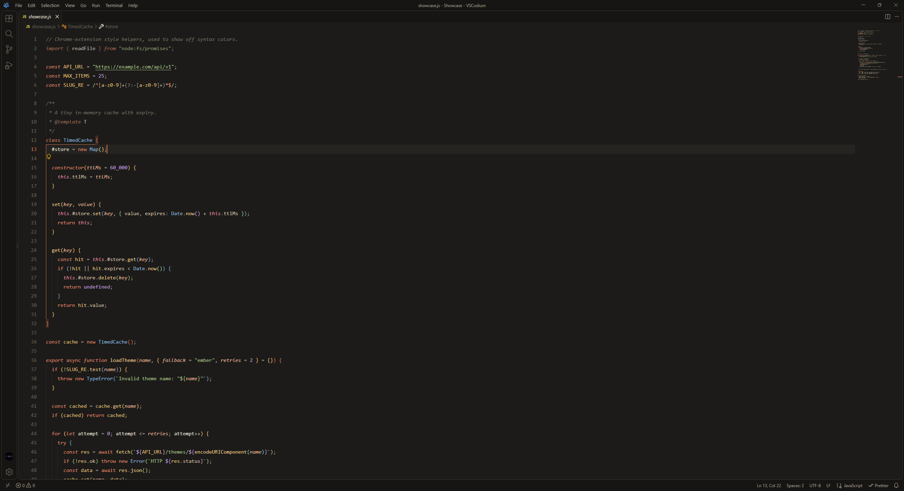
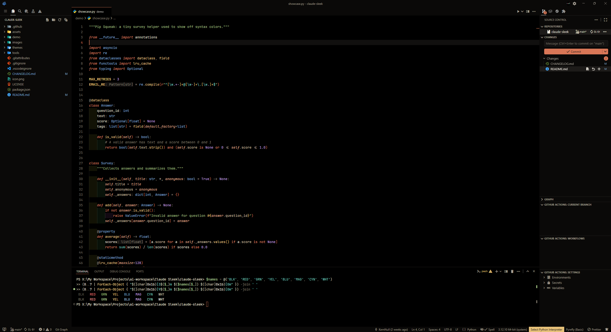
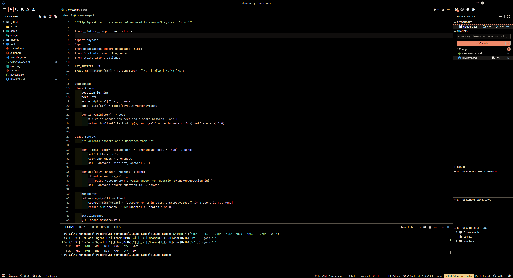
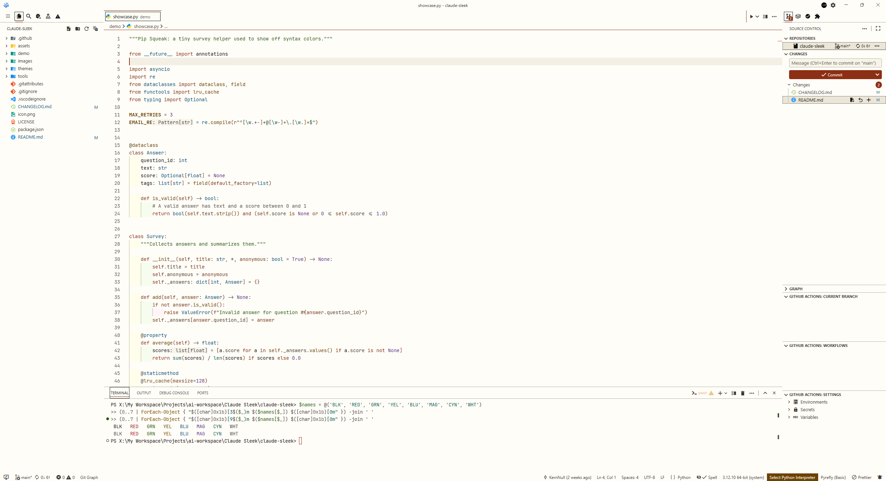
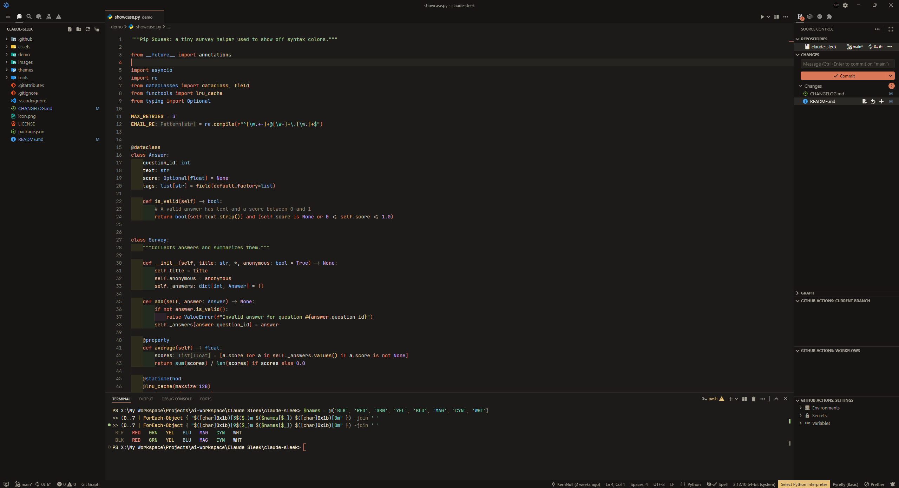
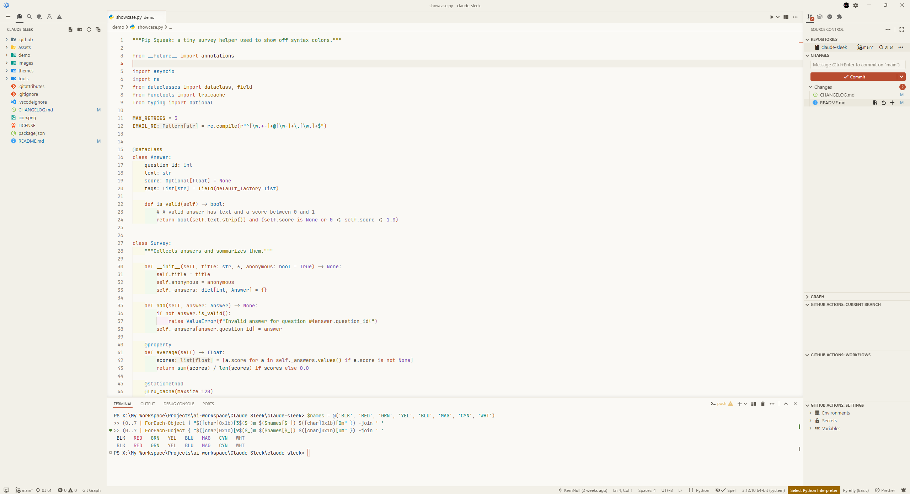

<p align="center">
  
</p>

# Claude Sleek

Warm, modern, minimal color themes built around a terracotta accent. Three looks (dark, true black, light), each with a no-italics variant, plus High Contrast versions of the dark and light themes. Tuned for readable code and a calm, flat interface.

> Unofficial. This is a fan-made theme inspired by Claude's look and is not affiliated with or endorsed by Anthropic.

## Themes

| Theme | Mode | What it is |
| --- | --- | --- |
| **Claude Ember** | dark | The main dark theme. Warm charcoal (`#1c1b19`) with a terracotta accent, built to be easy on the eyes through a long day. |
| **Claude Ember Black** | dark | Ember's exact colors on true black (`#000000`) with near-black panels. Deeper contrast, and it saves power on OLED screens. |
| **Claude Parchment** | light | The light theme. Cream paper (`#faf9f5`), ink-dark text and a deeper terracotta accent so everything stays readable on a bright background. |
| **Claude Ember (No Italics)** | dark | Ember without italic text. |
| **Claude Ember Black (No Italics)** | dark | Ember Black without italic text. |
| **Claude Parchment (No Italics)** | light | Parchment without italic text. |
| **Claude Ember High Contrast** | high contrast dark | True black with brighter text and syntax (7:1 contrast) and outlined widgets. No italics. |
| **Claude Parchment High Contrast** | high contrast light | Near-white paper with ink-dark text, a deep terracotta accent (7:1 contrast) and outlined widgets. No italics. |

The No Italics variants use exactly the same colors as their parent themes. They only drop the italics on comments, parameters, `this` / `self`, keywords such as `class`, `async` and `import`, HTML attributes, CSS pseudo-selectors, and Markdown emphasis and quotes. Pick them if your font has an italic style you dislike.

The High Contrast themes are tuned separately: every text color clears 7:1 against the background, and VS Code outlines panels, tabs and widgets with the theme's border color. VS Code can switch to a high contrast theme automatically if you set `window.autoDetectColorScheme` and your operating system is in a high contrast mode.

## Screenshots

Every screenshot shows [`demo/showcase.py`](demo/showcase.py) in VSCodium with the explorer, tabs and a terminal open, so one image covers the editor, the interface and the terminal colors. Click an image for the full size.

| Claude Ember | Claude Ember Black | Claude Parchment |
| :---: | :---: | :---: |
| <a href="https://raw.githubusercontent.com/KernNull/claude-sleek/main/images/ember.png"></a> | <a href="https://raw.githubusercontent.com/KernNull/claude-sleek/main/images/ember-black.png"></a> | <a href="https://raw.githubusercontent.com/KernNull/claude-sleek/main/images/parchment.png"></a> |

| Claude Ember High Contrast | Claude Parchment High Contrast |
| :---: | :---: |
| <a href="https://raw.githubusercontent.com/KernNull/claude-sleek/main/images/ember-high-contrast.png"></a> | <a href="https://raw.githubusercontent.com/KernNull/claude-sleek/main/images/parchment-high-contrast.png"></a> |

<details>
<summary>No Italics variants</summary>

| Claude Ember (No Italics) | Claude Ember Black (No Italics) | Claude Parchment (No Italics) |
| :---: | :---: | :---: |
| <a href="https://raw.githubusercontent.com/KernNull/claude-sleek/main/images/ember-no-italics.png"></a> | <a href="https://raw.githubusercontent.com/KernNull/claude-sleek/main/images/ember-black-no-italics.png"></a> | <a href="https://raw.githubusercontent.com/KernNull/claude-sleek/main/images/parchment-no-italics.png"></a> |

</details>

## Features

- Flat, borderless chrome: activity bar, sidebar, tabs, title bar and status bar share one calm tone.
- Terracotta accent on the active tab, cursor, active line number, buttons and badges.
- Bracket pair colors with soft guides, and semantic highlighting tuned to the palette.
- Tuned syntax for Markdown, JSON, YAML, HTML, CSS/SCSS, TypeScript, Python, Rust, Go, C/C++, Java, PHP, Ruby, shell, TOML/INI, SQL, Dockerfile, XML, diff and regular expressions.
- Styled sticky scroll, outline and symbol icons, notebooks, tests, settings editor, source control graph, merge editor, debug console and chat panels.
- Full 16-color terminal palette, readable in every theme (including "black" text and dim ANSI text).
- Text colors checked against WCAG contrast: 4.5:1 for text, 3:1 for line numbers and icons, and 7:1 for text in the High Contrast themes.

## Install

**VSCodium / any editor using Open VSX:** open the Extensions view and search for **Claude Sleek**.

**From a VSIX:** download `claude-sleek-2.0.0.vsix` from the Releases page, then Extensions view, `...` menu, **Install from VSIX...**.

**Manually:** copy this folder into your extensions folder (`%USERPROFILE%\.vscode-oss\extensions\` for VSCodium, `~/.vscode/extensions/` for VS Code) and restart.

Then press `Ctrl+K Ctrl+T` and pick a theme. Requires VS Code (or VSCodium) 1.65 or newer.

## Optional settings

```json
{
  "workbench.colorTheme": "Claude Ember",
  "window.autoDetectColorScheme": true,
  "workbench.preferredDarkColorTheme": "Claude Ember",
  "workbench.preferredLightColorTheme": "Claude Parchment",
  "editor.semanticHighlighting.enabled": true,
  "editor.bracketPairColorization.enabled": true,
  "editor.guides.bracketPairs": "active",
  "editor.fontLigatures": true
}
```

## Customize the accent

Swap the terracotta for another color without editing the theme:

```json
{
  "workbench.colorCustomizations": {
    "[Claude Ember]": {
      "button.background": "#7fb0dc",
      "textLink.foreground": "#7fb0dc",
      "tab.activeBorderTop": "#7fb0dc",
      "activityBar.activeBorder": "#7fb0dc",
      "activityBarBadge.background": "#7fb0dc",
      "badge.background": "#7fb0dc",
      "editorCursor.foreground": "#7fb0dc"
    }
  }
}
```

Use these colors for the same keys. Each one already clears 4.5:1 contrast in the theme it is listed under:

| Accent | Ember and Ember Black | Parchment |
| --- | --- | --- |
| Blue | `#7fb0dc` | `#1d6ba5` |
| Sage | `#a6c987` | `#4a7a2e` |
| Violet | `#c3a1e8` | `#7d47b0` |
| Gold | `#e8c27a` | `#9c6600` |

The key must match the theme name exactly, so the override above only affects Claude Ember. If you use another variant, repeat the block under its own key, such as `"[Claude Ember Black]"`, `"[Claude Parchment]"` or `"[Claude Ember (No Italics)]"`. The High Contrast themes are best left as they are, since changing their accent can drop them below 7:1.

## Palette

| Role | Ember | Parchment |
| --- | --- | --- |
| Background | `#1c1b19` (Black: `#000000`) | `#faf9f5` |
| Raised surfaces | `#24221f` (Black: `#141211`) | `#f5f3ec` |
| Accent | `#d97757` | `#b84d30` |
| Keywords | `#e48a6c` | `#b84d2d` |
| Strings | `#abc58c` | `#4a7a2e` |
| Functions | `#efca8e` | `#8a5800` |
| Types | `#8fbde3` | `#1d6ba5` |
| Numbers | `#c8a5ea` | `#7d47b0` |

## Demo files

The `demo/` folder has small sample files (Python, JavaScript, TypeScript, Rust, Go, C++, Java, PHP, Ruby, shell, SQL, TOML, INI, XML, Dockerfile, diff, Markdown, JSON, YAML, HTML and CSS) for trying the themes and comparing changes.

## Development

The theme files are generated from the palettes in one script, so a color change is a one-line edit:

```
python tools/generate_themes.py         # rebuild themes/ and the theme list in package.json
python tools/generate_themes.py --check # fail if the committed files differ from the script's output
python tools/check_contrast.py          # check every theme for valid colors and readable contrast
python tools/check_parity.py            # check each No Italics theme matches its parent
python tools/check_keys.py              # check every theme defines the same keys
python tools/check_release.py           # check the version and theme list agree everywhere
```

GitHub Actions runs all of these on every push and pull request.

## Feedback

Spotted a color that looks off? Open an issue with a screenshot and the file type.

## License

MIT, see [LICENSE](LICENSE).